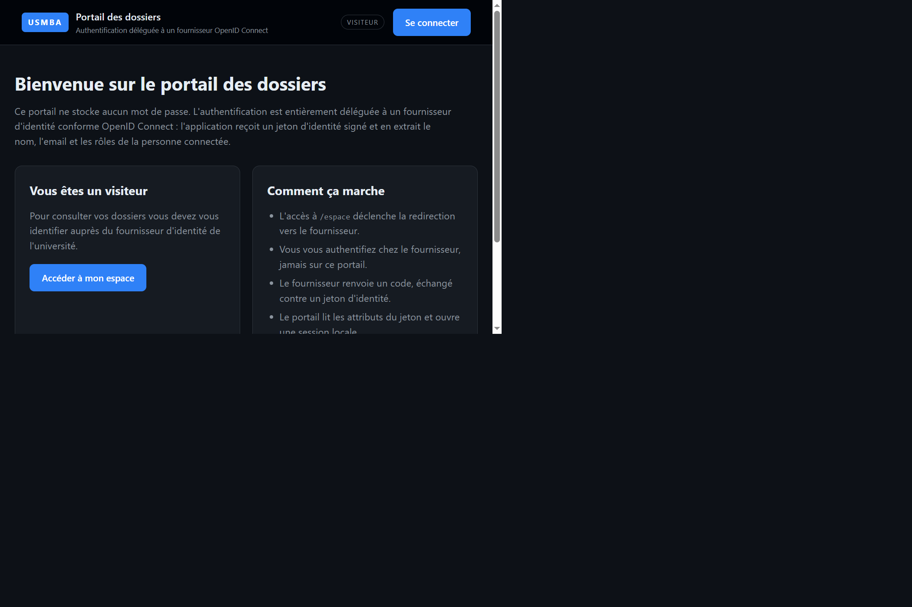
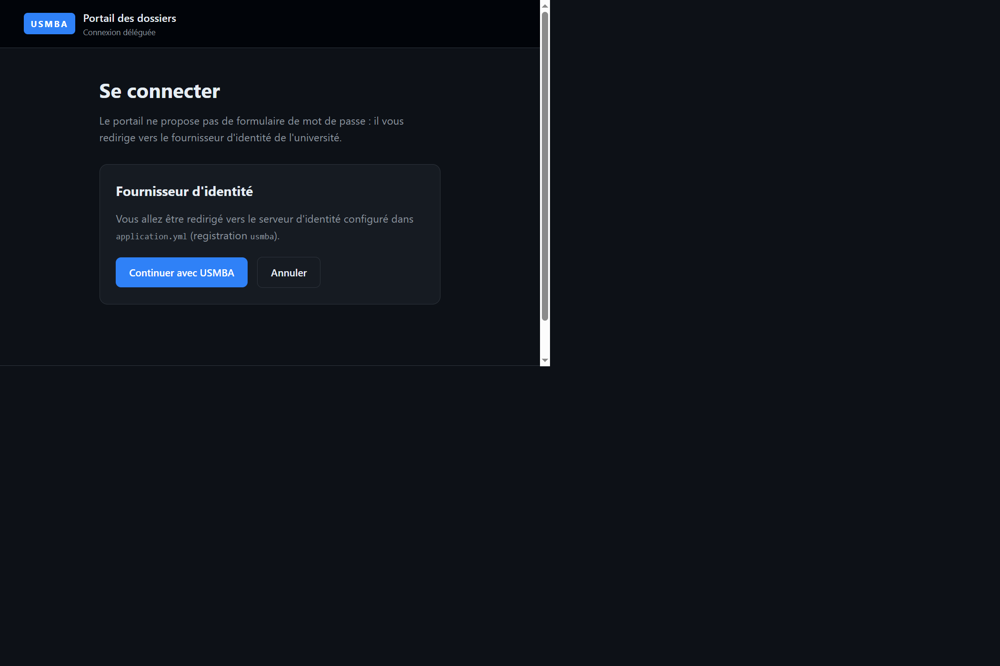
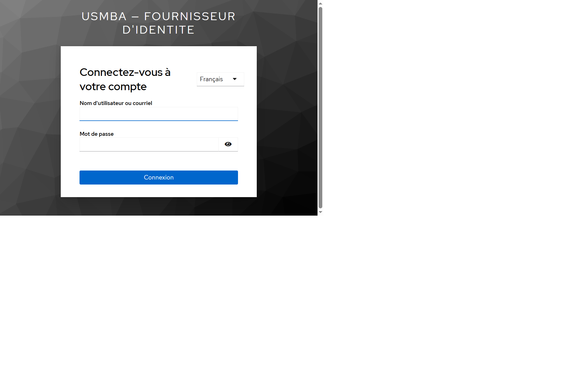
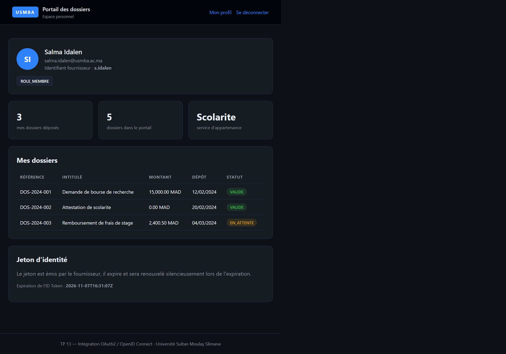
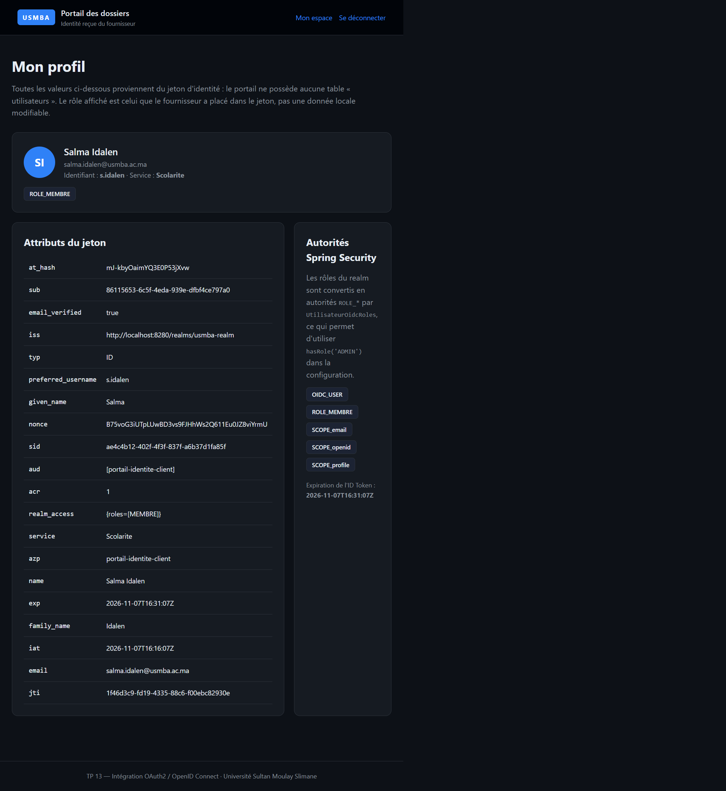
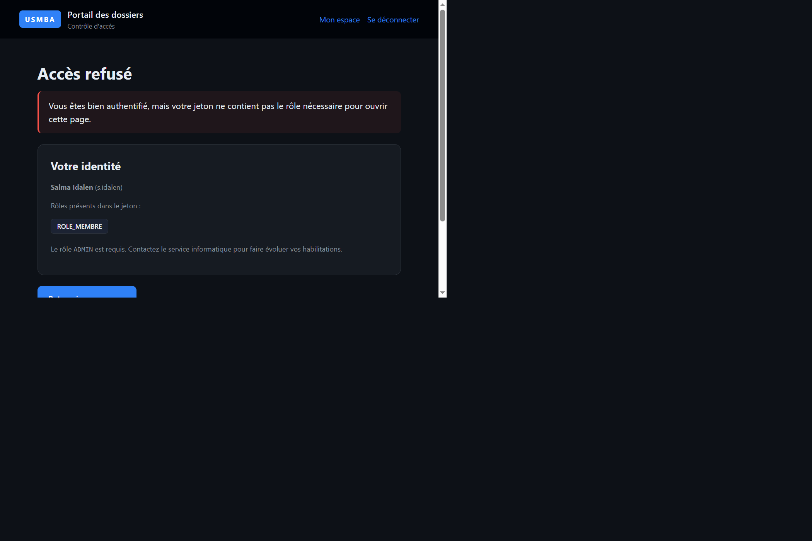
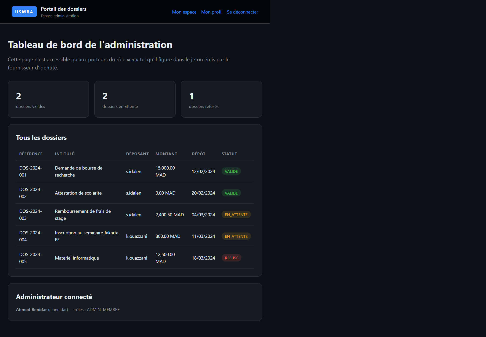
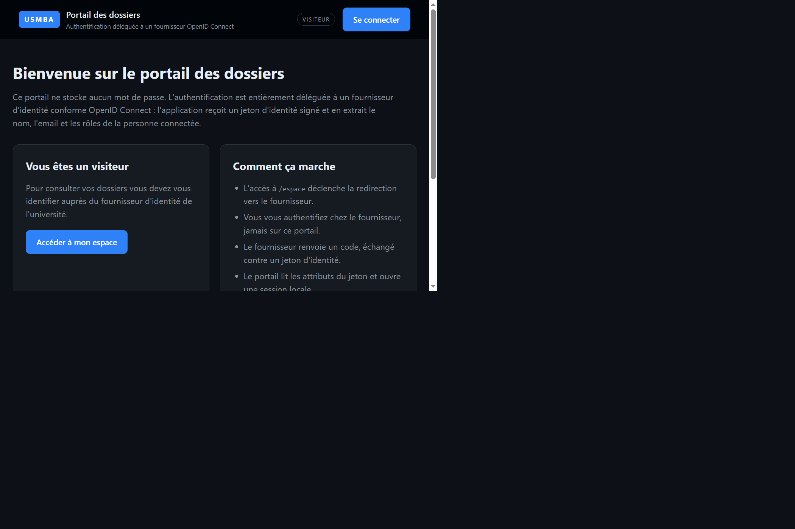

# TP 13 — Intégration OAuth2 / OpenID Connect avec Keycloak

Ce projet est la version personnelle du TP 13 du cours *Développement Jakarta EE : Spring*.
Le portail des dossiers de l'Université Sultan Moulay Slimane ne gère **aucun mot de passe** :
l'authentification est entièrement déléguée à un fournisseur d'identité compatible
**OpenID Connect**, ici une instance **Keycloak** lancée localement.

Le flux complet a été exécuté et photographié en conditions réelles : redirection vers le
fournisseur, formulaire de connexion, retour sur l'application, lecture des attributs du jeton
d'identité, contrôle d'accès par rôle et déconnexion.

## Ce que fait l'application

| Fonction | Détail |
| --- | --- |
| Page publique | `/` et `/accueil`, accessibles sans authentification |
| Connexion déléguée | `/connexion` puis redirection vers `/oauth2/authorization/usmba` |
| Espace personnel | `/espace` : dossiers du seul utilisateur connecté |
| Profil | `/profil` : tous les attributs du jeton et les autorités Spring Security |
| Administration | `/administration/tableau-de-bord` : réservé au rôle `ADMIN` |
| Déconnexion | `/deconnexion` : session invalidée, cookie supprimé |

Le portail ne possède **aucune table utilisateurs**. Tout ce qui est affiché provient des
claims du jeton d'identité émis par Keycloak.

## Données de démonstration

Le realm `usmba-realm` (fichier [keycloak/usmba-realm.json](keycloak/usmba-realm.json))
contient trois comptes :

| Utilisateur | Mot de passe | Rôles | Service | Dossiers |
| --- | --- | --- | --- | --- |
| `a.benidar` | `admin123` | ADMIN, MEMBRE | Direction des etudes | — |
| `s.idalen` | `membre123` | MEMBRE | Scolarite | DOS-2024-001, 002, 003 |
| `k.ouazzani` | `membre123` | MEMBRE, OBSERVATEUR | Affaires financieres | DOS-2024-004, 005 |

Les cinq dossiers sont chargés en mémoire par `CatalogueDossiers` : aucun SGBD n'est requis.

## Prérequis

- JDK 17 ou 21
- Maven 3.9+
- Keycloak 26 (distribution ZIP, aucun conteneur nécessaire)

## Lancer le projet

### 1. Démarrer le fournisseur d'identité

Copier le realm fourni dans le dossier d'import de Keycloak :

```bash
cp keycloak/usmba-realm.json <KEYCLOAK_HOME>/data/import/
```

Puis démarrer Keycloak sur le port **8280** :

```bash
<KEYCLOAK_HOME>/bin/kc.bat start-dev --http-port=8280 --import-realm
```

Le journal doit afficher `Realm 'usmba-realm' imported`, puis
`Listening on: http://0.0.0.0:8280`. La configuration du realm est vérifiable sur
`http://localhost:8280/realms/usmba-realm/.well-known/openid-configuration`.

### 2. Démarrer l'application

```bash
mvn spring-boot:run
```

L'application écoute sur **http://localhost:8100**. Aucune base de données n'est nécessaire.

### 3. Se connecter

Ouvrir `http://localhost:8100/espace` : le portail redirige vers la page de connexion
Keycloak du realm `usmba-realm`, puis revient sur `/espace`.

## Résultats obtenus

### Page d'accueil publique



La page racine est accessible sans authentification et n'affiche que le bandeau « visiteur ».
Elle explique en quatre points que le mot de passe n'est jamais saisi sur le portail : la
vérification a lieu chez le fournisseur, qui renvoie ensuite un jeton d'identité.

### Page de connexion du portail



Demander `/espace` sans session renvoie un 302 vers `/connexion`. Cette page ne contient
volontairement aucun champ mot de passe : elle ne sert qu'à présenter le fournisseur et à
proposer le bouton « Continuer avec USMBA » qui pointe vers `/oauth2/authorization/usmba`.

### Formulaire du fournisseur d'identité



Le clic sur le bouton précédent déclenche la redirection OpenID Connect. L'URL contient bien
`response_type=code`, `client_id=portail-identite-client`, `scope=openid profile email`,
un `state` et un `nonce` aléatoires, ainsi que
`redirect_uri=http://localhost:8100/login/oauth2/code/usmba`. Le formulaire affiché est celui
de Keycloak, en français, avec le nom du realm en en-tête : le portail ne voit jamais le mot de
passe.

### Espace personnel après authentification



Après l'échange du code d'autorisation contre un jeton, Spring Security ouvre une session
locale et redirige vers `/espace`. Le nom, l'email, l'identifiant fournisseur, le service et
les rôles sont lus dans le jeton. Seuls les dossiers du déposant connecté sont listés : ici les
trois dossiers de `s.idalen`, avec leurs statuts.

### Attributs du jeton et autorités Spring



La page `/profil` détaille tous les claims de l'ID Token : `iss`, `sub`, `aud`, `exp`, `iat`,
`nonce`, `preferred_username`, `email`, `realm_access`, le claim métier `service`, etc.
En dessous sont listées les autorités effectivement chargées dans le contexte de sécurité,
dont `ROLE_MEMBRE` construite à partir du claim `realm_access.roles`.

### Contrôle d'accès refusé



Avec le compte `s.idalen`, qui n'a que le rôle `MEMBRE`, l'URL
`/administration/tableau-de-bord` est refusée. Spring Security renvoie un 403 et affiche la page
`/acces-refuse`, qui rappelle l'identité connectée, les rôles réellement présents dans le jeton
et le rôle exigé. L'utilisateur reste authentifié : seul l'accès à la ressource est bloqué.

### Tableau de bord de l'administration



Après déconnexion puis connexion avec `a.benidar`, porteur du rôle `ADMIN`, la même URL répond
cette fois en 200. Le tableau de bord présente les compteurs par statut et l'intégralité des cinq
dossiers, tous déposants confondus, avec la ligne de rappel de l'administrateur connecté.

### Déconnexion



`/deconnexion` invalide la session, efface le contexte de sécurité et supprime le cookie
`PORTAIL_SESSION`, puis redirige vers l'accueil avec un message de confirmation. Le bandeau
repasse en « visiteur » : l'accès à `/espace` redéclenchera une nouvelle authentification.

## Choix d'implémentation

- **Variante Keycloak.** L'énoncé propose Google ou Keycloak. La variante Keycloak a été
  retenue afin de disposer d'un fournisseur réel, local et reproductible, sans dépendre de
  secrets Google Cloud.
- **Rôles du realm exposés dans l'ID Token.** Keycloak place par défaut les rôles dans
  l'*access token* seulement. Deux *protocol mappers* ont été ajoutés au client pour publier
  `realm_access.roles` et l'attribut métier `service` dans l'ID Token et dans UserInfo.
- **Conversion en autorités Spring.** La classe `UtilisateurOidcRoles` décore l'`OidcUser`
  renvoyé par `OidcUserService` et ajoute une autorité `ROLE_*` par rôle du realm. C'est ce qui
  permet d'écrire `hasRole("ADMIN")` dans la configuration.
- **Page d'accès refusé dédiée.** `accessDeniedPage("/acces-refuse")` évite la page d'erreur
  par défaut et rend le contrôle de rôle lisible. La route est déclarée `permitAll` pour ne pas
  provoquer de boucle de redirection.
- **Déconnexion en GET.** `/deconnexion` est un simple lien, sans jeton CSRF, pour rester
  utilisable depuis la barre de navigation. En production, une déconnexion POST avec CSRF et
  une terminaison de session côté fournisseur (`end_session_endpoint`) seraient préférables.
- **Domaine métier minimal.** Un catalogue de dossiers en mémoire donne un contenu réaliste
  aux écrans et permet de démontrer une règle de filtrage par déposant.

## Personnalisation par rapport à l'énoncé

| Élément | Énoncé | Projet rendu |
| --- | --- | --- |
| Groupe Maven | `ma.ens.security` | `ma.usmba` |
| Artifact | `oauth2-client` | `portail-identite-oauth2` |
| Package de base | `ma.ens.security` | `ma.usmba.identite` |
| Port de l'application | 8080 | **8100** |
| Fournisseur | Google (`accounts.google.com`) | **Keycloak local**, port **8280** |
| Realm | `ens-realm` | `usmba-realm` |
| Client OAuth2 | `spring-oauth-client` | `portail-identite-client` |
| Identifiant de registration | `google` | `usmba` |
| Page de connexion | `/login` | `/connexion` |
| Cible après succès | `/profile` | `/espace` |
| Contrôleur | `HomeController` | `ControleurPortail` + `ControleurAdministration` |
| Classe de configuration | `SecurityConfig` | `ConfigSecurite` |
| Cookie de session | `JSESSIONID` | `PORTAIL_SESSION` |
| Vues | `index.html`, `profile.html` | `accueil`, `connexion`, `espace`, `profil`, `administration`, `acces-refuse` |
| Rôles | non traités | `ADMIN` / `MEMBRE` / `OBSERVATEUR` + autorisation `/administration/**` |

Le domaine métier (dossiers, statuts, dépôts) et la charte graphique sont également propres au
projet.

## Structure du projet

```
src/main/java/ma/usmba/identite
├── PortailIdentiteApplication.java
├── config
│   ├── ConfigSecurite.java          # règles d'accès, oauth2Login, logout
│   └── UtilisateurOidcRoles.java    # realm_access.roles -> ROLE_*
├── modele
│   ├── Dossier.java
│   └── ProfilConnecte.java
├── service
│   ├── CatalogueDossiers.java
│   └── ServiceProfil.java
└── web
    ├── ControleurAdministration.java
    └── ControleurPortail.java
src/main/resources
├── application.yml                  # registration + provider OIDC
├── static/styles/portail.css
└── templates/*.html
keycloak/usmba-realm.json            # realm importable dans Keycloak
docs/screenshots/                    # captures réelles
```
